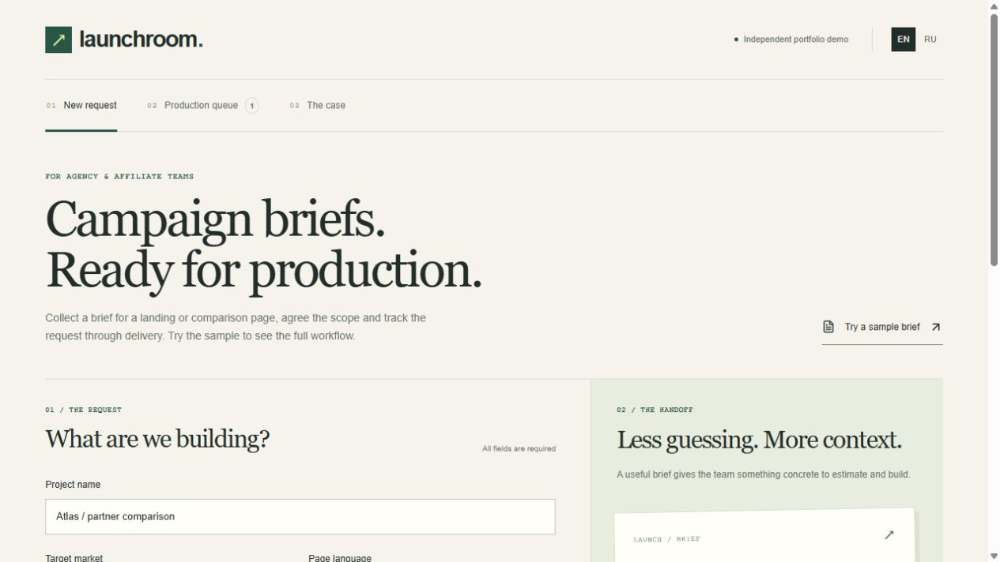
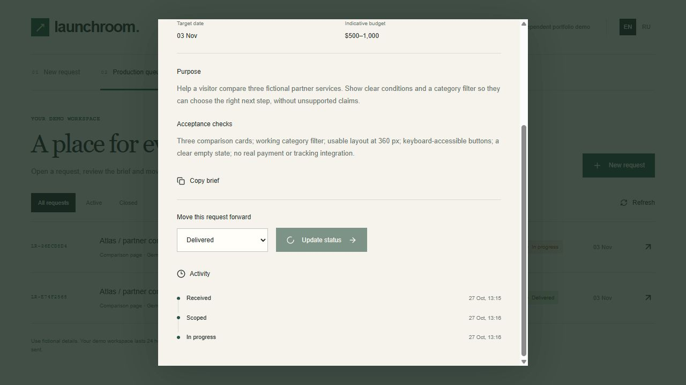

# Launchroom

[Live demonstration](https://launchroom-dmitry.wivy606.chatgpt.site) · [Русский разбор](README.ru.md) · [Case study](CASE-STUDY.md)

A manager requests a landing or comparison page. The team gets one structured brief, confirms scope and records delivery. This small tool demonstrates that workflow end to end.

This is an internal production tool for an agency/affiliate team, not a casino or a player-facing gaming website.

A bilingual campaign brief and production queue. Independent portfolio demonstration by Dmitry Mikhailov, made with AI assistance. Fictional data; no NDA materials.

See [the case study](CASE-STUDY.md) for the problem, implemented behavior, evidence and production boundaries.

## Try it in one minute

1. Load the sample brief and submit it.
2. Open the saved request and move it through scope, work and delivery.
3. Reload the page to verify persistence, then inspect its history.





## Stack

React 19, TypeScript, Vinext, Cloudflare Workers, D1/SQLite and Drizzle schema migrations. UI icons: Lucide. No external service credentials are required by the application.

## Local development

Node >=22.13. Install the checked-in dependency lockfile using the supplied installer. The project uses the portable Sites profile on Windows/macOS/Linux.

```sh
npm ci
npm run test
npm run typecheck
npm run db:generate # only after schema changes
npm run build
node --import ./scripts/sites-env.mjs ./node_modules/wrangler/bin/wrangler.js d1 execute DB --local --config dist/server/wrangler.json --persist-to .wrangler/state --file drizzle/0000_faithful_lady_bullseye.sql
npm run dev -- --port 5173 --hostname 127.0.0.1
```

Apply the initial migration once to a fresh local database. Both development and built preview share `.wrangler/state`. Production publishing is handled by the Sites workflow; the local migration command never targets production.

With the local server running:

```sh
npm run test:api
```

The API smoke checks create synthetic requests in random isolated local workspaces. Do not run these bulk creation checks against a shared production service. Browser interaction tests use the actual UI.

## Data and deployment

`.openai/hosting.json` retains the Site identity and DB binding. The source workflow publishes the same committed source as the deployment archive. Local runtime state, database contents, secrets, dependency folders and output archives are ignored by Git.

Source contains neither customer data nor client work. The hosted site's audience is managed separately from the source. A public portfolio link should only be advertised after public access is enabled and verified.

The original framework/runtime instructions are preserved in `RUNTIME.md`.
